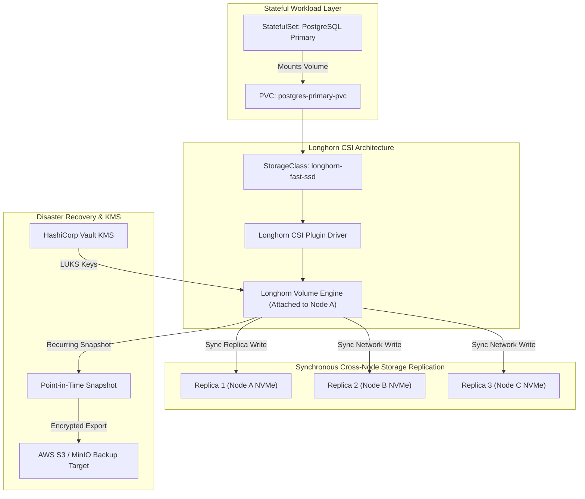

# Longhorn Cloud-Native Distributed Block Storage Platform (`tp-longhorn`)

[](https://slsa.dev)
[](https://talaripradeep.info)
[](LICENSE)
[](https://github.com/Pradeeptalari14/tp-longhorn/actions)

> **Production Repository:** [`Pradeeptalari14/tp-longhorn`](https://github.com/Pradeeptalari14/tp-longhorn)  
> **Interactive Studio Workspace:** [https://talaripradeep.info/tools/longhorn/](https://talaripradeep.info/tools/longhorn/)  
> **Visual Flow Canvas:** [https://talaripradeep.info/studios/flow/?studio=longhorn](https://talaripradeep.info/studios/flow/?studio=longhorn)  
> **Architecture Center:** [https://talaripradeep.info/architecture/](https://talaripradeep.info/architecture/)

---

## 🏛️ Production Architecture Flow



---

## 🛡️ Core Engineering & 9+ DevSecOps / SRE Governance Principles

This platform implements the **9+ enterprise DevSecOps and SRE governance principles**, ensuring audited supply-chain security, zero-drift declarative state, and automated resilience:

| Governance Pillar | Implementation in Longhorn Platform | Production Guarantee |
|---|---|---|
| **1. Cosign SLSA L3** | Verify cryptographic signatures on all Longhorn CSI driver images | Prevents malicious tampering with the storage management plane |
| **2. Semgrep AST** | Scan PersistentVolumeClaims and StorageClasses for missing encryption tags | Enforces LUKS encryption on all persistent data volumes |
| **3. CycloneDX SBOM** | Syft SBOM validation of Longhorn engine, manager, and replica binaries | Zero High/Critical CVEs across the persistent storage stack |
| **4. Kyverno Admission** | Enforce automated recurring backup policies on all database PVCs | Guarantees RPO < 60 minutes and automated S3 backup schedules |
| **5. eBPF Tetragon** | Monitor file and block device I/O patterns at the host kernel layer | Detects anomalous read spikes and potential ransomware encryption patterns |
| **6. GitOps Zero-Drift** | Declarative StorageClasses and BackupTargets versioned in Git | Eliminates manual UI tweaks and ensures storage configuration parity |
| **7. MELT Signals** | Export volume IOPS, read/write latency, and replica health metrics | Immediate Prometheus alerting on degraded volume states |
| **8. Automated SRE Repair** | Automated replica rebuild when a worker node crashes or disk fails | Maintains 3-copy redundancy without human intervention |
| **9. Zero-Trust Storage** | Encrypted-at-rest volumes via dm-crypt/LUKS with dynamic keys | Protects physical disks against data theft and unauthorized mounts |

---

## 💻 Infrastructure & Software Technology Stack

| Architectural Layer | Technology & Tools | Production Role |
|---|---|---|
| **Storage Engine** | Longhorn Engine & Manager v1.6+ | Microservice-based controller managing per-volume replicated storage |
| **CSI Interface** | Kubernetes Container Storage Interface (CSI) Driver | Handles dynamic provisioning, volume expansion, and node attachments |
| **Data Plane** | iSCSI Target & Linux Block Devices | Block-level synchronous replication over standard Ethernet fabrics |
| **Encryption** | Linux dm-crypt / LUKS with Vault KMS | Transparent encryption-at-rest for all persistent volume blocks |
| **Backup & DR** | S3 API / MinIO Remote Backup Target | Offsite snapshotting with incremental block deduplication |
| **Monitoring** | Prometheus CSI Exporter, Longhorn UI Dashboard | Live tracking of volume health, rebuilding progress, and storage capacity |

---

## 🎯 Where to Use (Real-World Production Scenarios)

### 1. Highly Available Database Persistence
Deploy production PostgreSQL, MySQL, and MongoDB clusters with 3x synchronous block replication across independent Kubernetes worker nodes and availability zones.

### 2. Multi-Cloud Disaster Recovery with S3 Snapshots
Take automated hourly point-in-time snapshots and replicate them to Amazon S3 or MinIO. Restore stateful services into secondary regions in minutes.

### 3. Encrypted Multi-Tenant Persistent Storage
Enforce automated per-volume LUKS encryption with keys sourced from HashiCorp Vault, ensuring zero data leakage in multi-tenant environments.

---

## 📋 Step-by-Step SRE Deployment & Verification Runbook

### Phase 1: Longhorn StorageClass & Volume Provisioning
```bash
# 1. Install Longhorn via Helm
helm install longhorn longhorn/longhorn --namespace longhorn-system --create-namespace

# 2. Apply production StorageClass and sample database PVC
kubectl apply -f storageclass.yaml

# 3. Verify StorageClass is available and marked ready
kubectl get sc longhorn-fast-ssd
```

### Phase 2: Health Verification & Replica Inspection
```bash
# Verify volume and replica health across nodes
kubectl get volumes.longhorn.io -n longhorn-system -o wide
kubectl get replicas.longhorn.io -n longhorn-system

# Check PersistentVolume status and mount bindings
kubectl get pvc -n database
kubectl describe pvc postgres-primary-pvc -n database
```

### Phase 3: SRE Triage & Failure Remediation Matrix
| Incident Symptom | Underlying Root Cause | Rapid SRE Remediation Command |
|---|---|---|
| **Volume in Degraded State** | One worker node crashed or disk detached, leaving 2/3 replicas | Longhorn auto-rebuilds; check `kubectl get replicas.longhorn.io -n longhorn-system` |
| **Volume Attachment Timeout** | iSCSI daemon not running on target worker node | Verify iSCSI on host: `sudo systemctl status iscsid && sudo systemctl restart iscsid` |
| **Backup Target Sync Failure** | Invalid S3 IAM credentials or MinIO network partition | Verify S3 secret in Longhorn: `kubectl describe secret -n longhorn-system minio-secret` |
| **PVC Expansion Stuck** | Host filesystem resize pending filesystem flush | `kubectl patch pvc <name> -n database --type='json' -p='[{"op":"replace","path":"/spec/resources/requests/storage","value":"300Gi"}]'` |

---

## 🚀 Quickstart & Verification Drill

```bash
# 1. Clone repository
git clone https://github.com/Pradeeptalari14/tp-longhorn.git
cd tp-longhorn

# 2. Run automated validation script
chmod +x scripts/validate.sh
./scripts/validate.sh
```

---

## 📄 License & Security Policy

- **License**: [MIT License](LICENSE) — Copyright (c) 2026 Talari Pradeep. All rights reserved.
- **Security Policy**: See [SECURITY.md](SECURITY.md) for vulnerability disclosure and triage workflows.

---
*Synchronized with [Talari Pradeep Developer Studios](https://talaripradeep.info/studios/) & [Repository Learning DAG](https://talaripradeep.info/tools/repo-learning/)*
